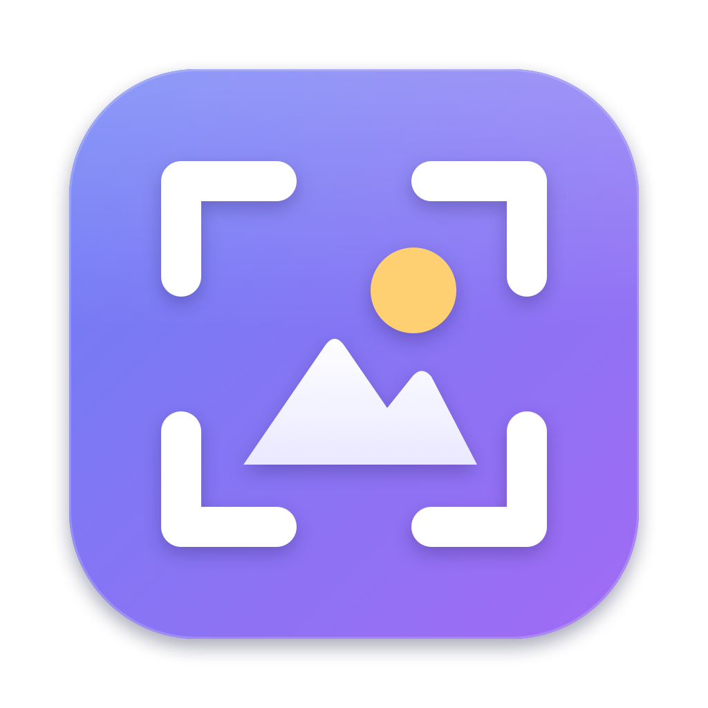
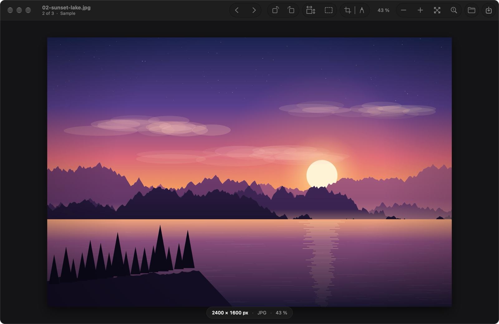
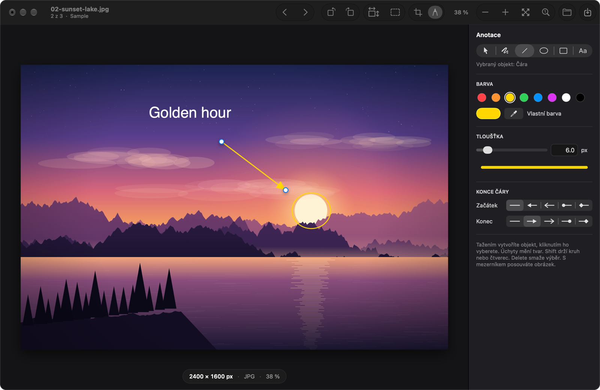
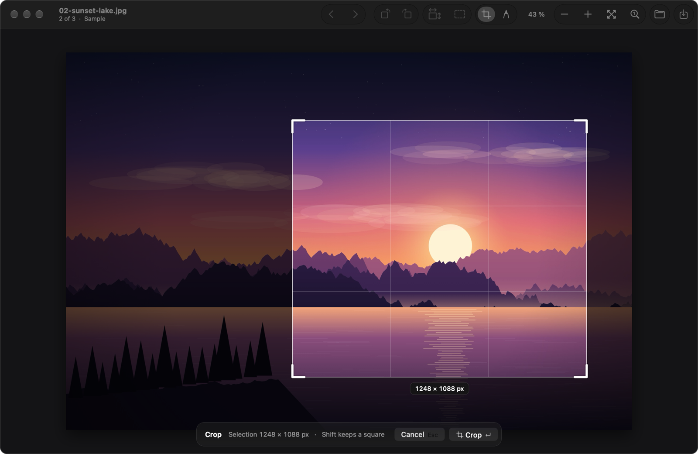
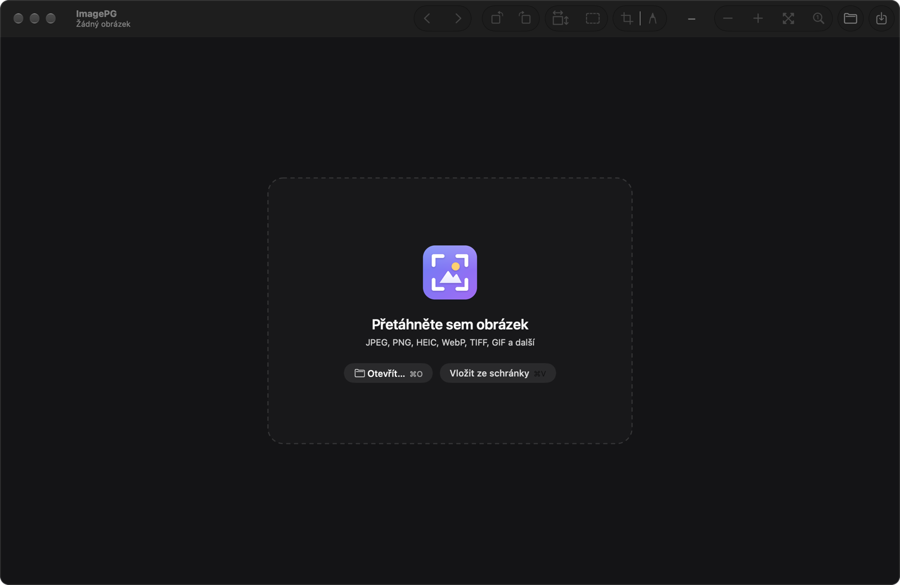

<p align="center">
  
</p>

<h1 align="center">ImagePG</h1>

<p align="center">
  A fast, minimal native image viewer and editor for <strong>macOS</strong>.<br>
  Open, browse, crop, resize, rotate, annotate, print and convert images without leaving one small, quiet window.
</p>

<p align="center">
  <a href="https://github.com/html-koder-com/imagepg/releases/latest">Download for Mac</a> ·
  <a href="#build-from-source">Build from source</a> ·
  <a href="README.cs.md">Česky</a>
</p>

<p align="center">
  
</p>

---

## About

ImagePG is a free, open-source **Mac app** written in Swift with AppKit. It has no dependencies, no accounts and no telemetry. It was built for speed: it shows a small preview immediately, loads the full-resolution image in the background and prefetches the neighbouring files in the folder, so you can move through a folder with the arrow keys.

- **Platform:** macOS 14 Sonoma or newer, Apple Silicon and Intel (universal binary)
- **Languages:** English, Czech, Slovak, German, French, Polish and Hungarian. The app follows your macOS language; to pick another one, open **ImagePG → Settings… (⌘,)** and choose it under *Language*. ImagePG offers to restart so the change takes effect.
- **License:** [MIT](LICENSE). Use it, fork it, change it and ship it.

## Features

- **Viewer:** open from Finder, the Open dialog, drag & drop or the clipboard (⌘V). Browse the folder with ← / →. Zoom with the toolbar, the keyboard, the scroll wheel or a pinch gesture, and the point under the cursor stays in place. Drag to pan.
- **Editing:** rotate by 90° or by any angle, resize the image, change the canvas size, and crop with a rule-of-thirds overlay and a live pixel readout.
- **Annotations:** pen, line with configurable arrow heads, ellipse, rectangle and text. A contextual inspector shows only the settings of the active tool. It includes a colour palette and an eyedropper that samples the original pixels, which is handy for covering parts of a photo with the surrounding colour.
- **Formats:** everything ImageIO can read, including HEIC, WebP and AVIF where macOS supports them. *Save As* lets you pick the format, compression quality and background for transparency.
- **Printing:** the system print dialog with a live preview, fit/fill/custom scale (0.1–1000 %) and PDF export.
- **Safe by default:** unsaved changes are never lost silently. You are asked to save, discard or cancel.

## Screenshots

<table>
  <tr>
    <td width="50%"></td>
    <td width="50%"></td>
  </tr>
  <tr>
    <td align="center"><sub><b>Annotations:</b> the inspector shows only what the active tool needs</sub></td>
    <td align="center"><sub><b>Crop:</b> rule-of-thirds grid and the result size in pixels</sub></td>
  </tr>
  <tr>
    <td width="50%"></td>
    <td width="50%"></td>
  </tr>
  <tr>
    <td align="center"><sub><b>Viewer:</b> browse a folder with ← / →</sub></td>
    <td align="center"><sub><b>Start:</b> drop an image, open it or paste it from the clipboard</sub></td>
  </tr>
</table>

<sub>The sample image in the screenshots is computer-generated.</sub>

## Install

1. Download `ImagePG-x.y.z.zip` from the [latest release](https://github.com/html-koder-com/imagepg/releases/latest).
2. Unzip it and move **ImagePG.app** to your *Applications* folder.
3. The app is open source and is not notarised by Apple, so the first launch needs one extra step: **right-click → Open**, then confirm. You can also allow it in *System Settings → Privacy & Security*. Alternatively, run:

   ```bash
   xattr -dr com.apple.quarantine /Applications/ImagePG.app
   ```

To open images with ImagePG by default, choose *Get Info* on an image in Finder, pick ImagePG under *Open with* and click *Change All…*.

## Keyboard shortcuts

| Action | Shortcut |
| --- | --- |
| Settings | ⌘, |
| Open / paste image | ⌘O / ⌘V |
| Save / Save As | ⌘S / ⇧⌘S |
| Previous / next image in folder | ← / → |
| Rotate left / right | L / R |
| Resize image | ⌘R |
| Crop | ⌘K, then ↵ to apply or Esc to cancel |
| Canvas size | ⇧⌘P |
| Print | ⌘P or Ctrl+P |
| Zoom in / out | ⌘+ / ⌘−, scroll wheel or pinch |
| Fit to window / actual size | ⌘0 / ⌘1 |
| Pan while annotating or cropping | hold Space and drag |
| Square / circle while drawing | hold Shift |
| Delete selected annotation | Delete |

## Build from source

Requirements: a Mac with **Xcode** or the Xcode Command Line Tools (Swift 5.10+).

```bash
git clone https://github.com/html-koder-com/imagepg.git
cd imagepg
./build-app.sh            # builds dist/ImagePG.app for this Mac
open dist/ImagePG.app
```

Useful scripts:

| Command | What it does |
| --- | --- |
| `UNIVERSAL=1 ./build-app.sh` | Builds an Apple Silicon + Intel app |
| `./Tools/run-checks.sh` | Compiles and runs the self-checks in `Tests/` |
| `./Tools/build-icon.sh` | Regenerates the app icon from `Tools/create-icon.swift` |
| `./Tools/package-release.sh` | Builds a universal app and zips it into `dist/` for a GitHub release |

### Project layout

```
Sources/ImagePG/   App code (AppKit): window, canvas, annotations, crop, dialogs, printing
Tests/             Small executable checks, run by Tools/run-checks.sh
docs/screenshots/  Images used in this README
Resources/         Info.plist, the app icon and translations (<lang>.lproj/Localizable.strings)
Tools/             Icon generator and helper scripts
```

## Contributing

Issues and pull requests are welcome, whether they are bug reports, fixes, translations or small improvements.

1. Fork the repository and create a branch.
2. Keep changes focused. Run `./Tools/run-checks.sh` before opening a pull request.
3. For UI changes, include a screenshot in the pull request.

### Adding a translation

1. Copy `Resources/en.lproj` to `Resources/<code>.lproj` (for example `it.lproj`) and translate the values on the right-hand side of `Localizable.strings` and `InfoPlist.strings`. Keep `%@` and `%d` placeholders.
2. Add the language code to `CFBundleLocalizations` in `Resources/Info.plist`.
3. Build the app and check that longer texts still fit, especially in the annotation inspector and the dialogs.

The app deliberately stays simple and dependency-free. If you plan a larger feature, open an issue first so we can agree on the direction.

## License

ImagePG is released under the [MIT License](LICENSE). You are free to use, copy, modify and distribute it, including commercially.
